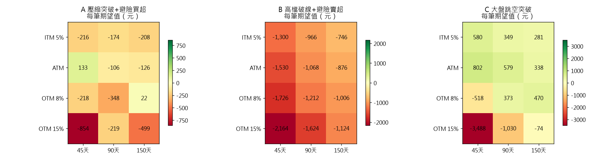

# 小資權證極短線量化回測（Warrant Quant）

用 Python 回答小資金買權證最常遇到的兩個問題：

1. **When to Buy**：用母股的「極短線動能突破」加上「自營商避險籌碼異常」找出 1~5 天內就會表態的買點，避免盤整時被 Theta 吃掉時間價值。
2. **Which Warrant**：用 Black-Scholes **合成權證**回測 4 種價內外程度 × 3 種剩餘天數，共 12 種規格，並把**真實摩擦成本**算進去（手續費低消、造市價差、tick 跳動、IV crush），回答「哪種規格最賺」。



## 回測結論（2018-01 ~ 2026-11，總資金 3 萬、單筆 1 萬）

| 策略 | 訊號數 | 最佳規格 | 每筆期望值 | 勝率 | 破產風險 |
|---|---|---|---|---|---|
| C 大盤跳空突破（0050 認購） | 107 | **價平 / 45 天** | +802 元 | 52% | 17% |
| C（穩健版） | 107 | 價內 5% / 45 天 | +580 元 | 58% | 8% |
| A 壓縮突破 + 避險買超（個股認購） | 119 | 價平 / 45 天 | +133 元 | 43% | 54% |
| B 高檔破線 + 避險賣超（個股認售） | 30 | 全部虧損 | −746 元 | 23% | ≈100% |

**從回測看到的幾件事**
- **深價外（OTM 15%）在每個策略都虧最多**：帳面槓桿雖然高達 25~43 倍，但價格太低，一個 tick 加上造市價差就吃掉大部分利潤，而且常常一進場就碰到停損。
- 短天期（45 天）只有搭配**價平、價內**才划算：Gamma 夠大，能在 5 天內把母股的漲幅放大。
- 個股的避險籌碼訊號（A/B）扣掉摩擦成本後不太穩定；放空訊號 B 尤其不可靠，因為台股長期偏多。
- 大盤順勢突破（C）是唯一在 12 種規格中大多數都賺錢的策略。

> ⚠️ 合成權證以「HV20 × 1.15」當造市 IV，沒有反映真實券商的 IV 調整與流動性，結果只能當研究參考，不構成投資建議。

## 架構

```
├── CLAUDE.md                 專案規範
├── config.yaml               資金、手續費折數、低消、價差、回測參數、Token（機密放 config.local.yaml）
├── specs/                    細節規格（資料管線 / 核心策略 / 推播）
├── data/
│   ├── market_fetcher.py     FinMind REST（免 token）抓日 K + 三大法人，獨立出「自營商避險」；HV20、ATR14、布林帶寬、均線、量比；自動還原股票分割
│   ├── us_night_fetcher.py   美股 / 匯率 / 台指期夜盤（待實作）
│   └── warrant_scraper.py    實盤權證清單 CSV 匯入與網頁接口
├── core/
│   ├── bs_warrant_sim.py     Black-Scholes 價格與 Greeks、實質槓桿、權證 tick、摩擦成本；12 種規格網格回測與 Bootstrap 破產風險
│   ├── letf_backtester.py    00631L 正二擇時回測（待實作）
│   ├── stock_radar.py        策略 A/B/C 訊號（布林壓縮、破線、跳空突破 + 自營商避險）
│   └── warrant_screener.py   實盤篩選：剔除天數 < 60、價差 > 2%、流通 > 80%、單價 < 0.6、槓桿 < 4；依槓桿、價差、相對 IV 評分取前 3
├── bot/notifier.py           Telegram / LINE 推播（待實作）
└── main.py                   CLI，輸出 results/report.md、grid_*.csv、ev_heatmap.png
```

## 使用

```bash
pip install -r requirements.txt
python main.py --mode backtest          # 第一次會下載資料並快取到 data/cache/
python main.py --mode backtest --refresh  # 重新下載資料
python -m core.warrant_screener sample_warrants.csv
```

想換成低消 1 元的券商，或模擬出場時 IV 被調降 1 個點，請修改 `config.yaml` 裡的 `cost.min_fee: 1`、`cost.iv_crush: 0.01`。

## 模型細節

- **合成權證發行**：Call 的履約價為 `K = S × (1 + m)`（m > 0 為價外），Put 則相反。行使比例會自動調整，讓發行價落在 1.5 元左右，接近市場上實際權證的報價區間。
- **成交價**：買進時用委賣價，也就是理論價 × (1 + 0.85%) 再無條件進位到 tick；賣出時用委買價，也就是理論價 × (1 − 0.85%) 再無條件捨去。
- **費用**：手續費為 `max(成交金額 × 0.1425% × 折數, 低消)`，賣出時另收權證交易稅 0.1%。
- **資金曲線**：依時間順序計算，每筆投入 min(單筆預算, 剩餘資金)。破產風險的定義是：從實際交易報酬中重抽 50 筆，資金跌破初始 50% 的機率。
- **網格與 PROMPT 的差異**：PROMPT 寫「9 種」，但列出了 4 種價內外 × 3 種天數，這裡依照列出的項目跑滿 12 種。
- **樣本數**：除了指定的 2330、2317、0050，另外加入 2454、2303、2382、3231、2603 這幾檔權證熱門標的，讓個股策略有更多樣本。
