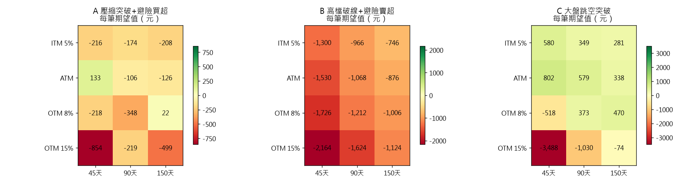

# 權證極短線策略回測報告

資料期間：2018-01-01 ~ 2026-11-09　｜　總資金 30,000、單筆 10,000、手續費 0.6 折低消 20 元、單邊價差 0.85%、IV crush 0.00%、最長持有 5 天、停利 40% / 停損 -30%

## A 壓縮突破+避險買超

訊號數 119，標的 2330, 2317, 2454, 2303, 2382, 3231, 2603

| 價內外     |   DTE |   交易數 | 勝率    | 平均報酬   |   期望值(元/筆) |   期末資金 | 總報酬     | 最大回撤    | 破產風險   |   平均槓桿 |   平均持有天 |
|:--------|------:|------:|:------|:-------|-----------:|-------:|:--------|:--------|:-------|-------:|--------:|
| ITM 5%  |    45 |   119 | 41.2% | -2.4%  |       -216 |      1 | -100.0% | -100.0% | 66.3%  |   10.3 |     3.9 |
| ITM 5%  |    90 |   119 | 42.0% | -1.9%  |       -174 |    130 | -99.6%  | -99.6%  | 60.8%  |    8   |     4.2 |
| ITM 5%  |   150 |   119 | 41.2% | -2.2%  |       -208 |  4,007 | -86.6%  | -89.3%  | 58.4%  |    6.6 |     4.5 |
| ATM     |    45 |   119 | 42.9% | 1.3%   |        133 |      3 | -100.0% | -100.0% | 53.5%  |   13.6 |     3.3 |
| ATM     |    90 |   119 | 41.2% | -1.3%  |       -106 |      7 | -100.0% | -100.0% | 61.0%  |    9.7 |     4.1 |
| ATM     |   150 |   119 | 41.2% | -1.4%  |       -126 |  6,193 | -79.4%  | -83.9%  | 55.6%  |    7.6 |     4.3 |
| OTM 8%  |    45 |   119 | 33.6% | -2.2%  |       -218 |      0 | -100.0% | -100.0% | 76.0%  |   20.3 |     2.6 |
| OTM 8%  |    90 |   119 | 38.7% | -3.7%  |       -348 |      0 | -100.0% | -100.0% | 75.2%  |   13   |     3.6 |
| OTM 8%  |   150 |   119 | 41.2% | -0.0%  |         22 |  2,786 | -90.7%  | -92.4%  | 55.9%  |    9.5 |     4.1 |
| OTM 15% |    45 |   119 | 28.6% | -8.5%  |       -854 |      0 | -100.0% | -100.0% | 89.1%  |   26.7 |     2   |
| OTM 15% |    90 |   119 | 37.8% | -2.1%  |       -219 |      0 | -100.0% | -100.0% | 72.5%  |   16   |     3.1 |
| OTM 15% |   150 |   119 | 37.0% | -5.3%  |       -499 |      0 | -100.0% | -100.0% | 81.0%  |   11.2 |     3.8 |

→ **最佳規格：ATM / 45 天**，每筆期望值 133 元、勝率 43%

## B 高檔破線+避險賣超

訊號數 30，標的 2330, 2317, 2454, 2303, 2382, 3231, 2603

| 價內外     |   DTE |   交易數 | 勝率    | 平均報酬   |   期望值(元/筆) |   期末資金 | 總報酬     | 最大回撤    | 破產風險   |   平均槓桿 |   平均持有天 |
|:--------|------:|------:|:------|:-------|-----------:|-------:|:--------|:--------|:-------|-------:|--------:|
| ITM 5%  |    45 |    30 | 23.3% | -14.2% |     -1,300 |    506 | -98.3%  | -98.7%  | 100.0% |    6.6 |     4.2 |
| ITM 5%  |    90 |    30 | 23.3% | -10.6% |       -966 |  2,408 | -92.0%  | -93.4%  | 99.9%  |    4.8 |     4.6 |
| ITM 5%  |   150 |    30 | 23.3% | -8.2%  |       -746 |  5,589 | -81.4%  | -83.8%  | 99.8%  |    3.7 |     4.9 |
| ATM     |    45 |    30 | 23.3% | -16.7% |     -1,530 |    156 | -99.5%  | -99.6%  | 100.0% |    7.8 |     4   |
| ATM     |    90 |    30 | 23.3% | -11.7% |     -1,068 |  1,489 | -95.0%  | -95.9%  | 100.0% |    5.4 |     4.6 |
| ATM     |   150 |    30 | 23.3% | -9.6%  |       -876 |  3,432 | -88.6%  | -90.1%  | 99.9%  |    4.1 |     4.7 |
| OTM 8%  |    45 |    30 | 23.3% | -18.8% |     -1,726 |     32 | -99.9%  | -99.9%  | 100.0% |   10.3 |     3.6 |
| OTM 8%  |    90 |    30 | 23.3% | -13.3% |     -1,212 |    725 | -97.6%  | -98.1%  | 100.0% |    6.6 |     4.4 |
| OTM 8%  |   150 |    30 | 23.3% | -10.9% |     -1,006 |  2,117 | -92.9%  | -94.0%  | 100.0% |    4.8 |     4.6 |
| OTM 15% |    45 |    30 | 26.7% | -23.1% |     -2,164 |      2 | -100.0% | -100.0% | 100.0% |   12.9 |     3.4 |
| OTM 15% |    90 |    30 | 20.0% | -17.6% |     -1,624 |    115 | -99.6%  | -99.7%  | 100.0% |    7.9 |     4.2 |
| OTM 15% |   150 |    30 | 23.3% | -12.2% |     -1,124 |  1,202 | -96.0%  | -96.7%  | 100.0% |    5.5 |     4.6 |

→ **最佳規格：ITM 5% / 150 天**，每筆期望值 -746 元、勝率 23%

## C 大盤跳空突破

訊號數 107，標的 0050

| 價內外     |   DTE |   交易數 | 勝率    | 平均報酬   |   期望值(元/筆) |    期末資金 | 總報酬     | 最大回撤    | 破產風險   |   平均槓桿 |   平均持有天 |
|:--------|------:|------:|:------|:-------|-----------:|--------:|:--------|:--------|:-------|-------:|--------:|
| ITM 5%  |    45 |   107 | 57.9% | 6.3%   |        580 |  97,783 | 225.9%  | -24.4%  | 7.9%   |   12.9 |     4.4 |
| ITM 5%  |    90 |   107 | 56.1% | 3.8%   |        349 |  71,047 | 136.8%  | -21.8%  | 7.8%   |   10.3 |     4.7 |
| ITM 5%  |   150 |   107 | 55.1% | 3.0%   |        281 |  62,574 | 108.6%  | -21.6%  | 5.4%   |    8.5 |     4.8 |
| ATM     |    45 |   107 | 52.3% | 8.5%   |        802 | 120,631 | 302.1%  | -37.3%  | 16.8%  |   18.8 |     3.8 |
| ATM     |    90 |   107 | 54.2% | 6.2%   |        579 |  96,079 | 220.3%  | -28.6%  | 8.8%   |   13.4 |     4.4 |
| ATM     |   150 |   107 | 54.2% | 3.6%   |        338 |  68,900 | 129.7%  | -22.8%  | 9.3%   |   10.4 |     4.7 |
| OTM 8%  |    45 |   107 | 33.6% | -5.2%  |       -518 |       0 | -100.0% | -100.0% | 83.0%  |   31.2 |     2.7 |
| OTM 8%  |    90 |   107 | 43.9% | 4.0%   |        373 |  50,887 | 69.6%   | -96.4%  | 37.2%  |   19.3 |     3.7 |
| OTM 8%  |   150 |   107 | 52.3% | 4.9%   |        470 |  82,722 | 175.7%  | -63.4%  | 15.6%  |   13.9 |     4.4 |
| OTM 15% |    45 |   107 | 18.7% | -34.8% |     -3,488 |       0 | -100.0% | -100.0% | 99.8%  |   43.2 |     1.8 |
| OTM 15% |    90 |   107 | 35.5% | -10.2% |     -1,030 |       0 | -100.0% | -100.0% | 94.2%  |   24.9 |     3   |
| OTM 15% |   150 |   107 | 44.9% | -0.5%  |        -74 |      46 | -99.8%  | -100.0% | 54.4%  |   17.1 |     3.8 |

→ **最佳規格：ATM / 45 天**，每筆期望值 802 元、勝率 52%

